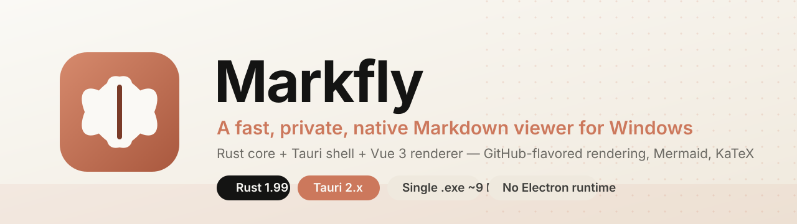
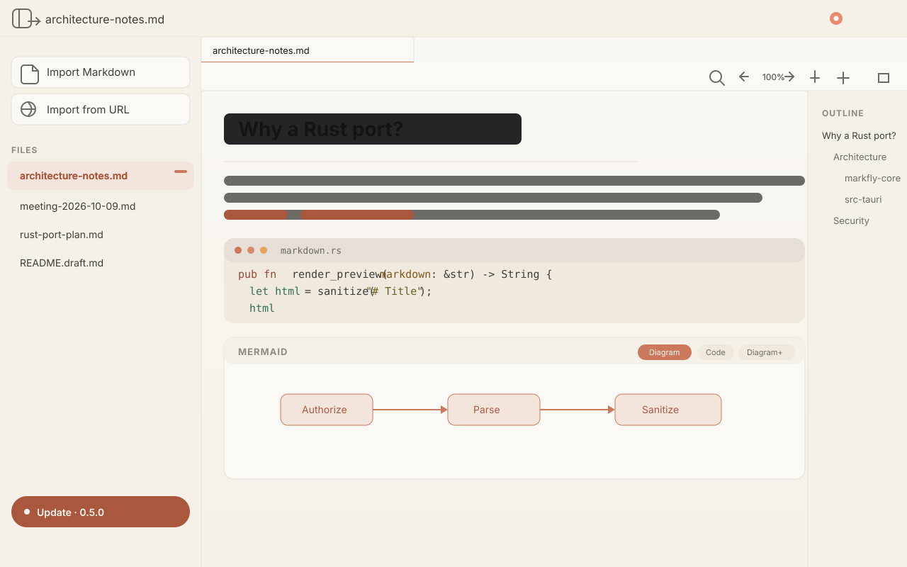
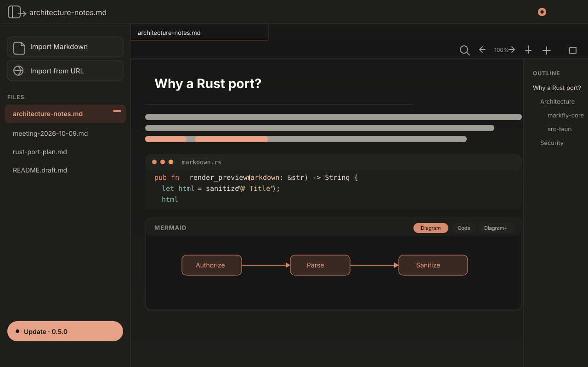
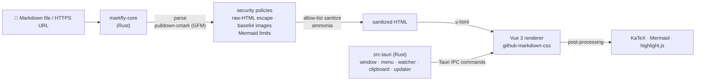

<p align="center">
  
</p>

<h1 align="center">Markfly_Win</h1>

<p align="center">
  <strong>A fast, private, native Markdown viewer for Windows — written in Rust.</strong>
</p>

<p align="center">
  
  
  
  
  
  
</p>

<p align="center">
  <a href="#-features">Features</a> ·
  <a href="#-install">Install</a> ·
  <a href="#-build-from-source">Build</a> ·
  <a href="#-architecture">Architecture</a> ·
  <a href="#-security-model">Security</a> ·
  <a href="#-roadmap">Roadmap</a>
</p>

---

## ✨ What is this?

**Markfly** is a desktop Markdown viewer: open a file, get beautifully rendered,
GitHub-flavored Markdown instantly — tables, task lists, Mermaid diagrams, KaTeX
math, and syntax highlighting, with an outline panel, tabs, find-in-document and
auto-reload.

This repository is a **complete Windows port of
[markfly.md](https://github.com/rizkidarmawan21/markfly.md)** — an Electron + Vue
app originally built for macOS — rebuilt with **Rust + Tauri**.

The Vue 3 renderer is preserved so rendering stays pixel-identical, while
**every line of system-level logic — the markdown pipeline, sandboxed file
access, URL import, file watching, clipboard, native menu, drag & drop, and the
auto-updater — has been reimplemented in Rust**.

| | Electron (original) | Rust port (this repo) |
|---|---|---|
| Runtime | Node + Chromium (~180 MB) | **none** — native WebView2 |
| Installer size | ~90 MB DMG | **~5 MB** MSI/NSIS |
| Peak memory | 300–500 MB | **~60–90 MB** |
| Core logic | TypeScript | **Rust** (framework-agnostic crate) |
| Platforms | macOS | **Windows** (arm64 ready) |

> 📖 Deep-dive analysis, full Electron→Rust API mapping, assumptions and
> compatibility notes: **[`PORTING-NOTES.md`](PORTING-NOTES.md)** (Bahasa Indonesia).

---

## 🚀 Features

- ⚡ **Native & tiny** — single ~9 MB `.exe`, no Electron runtime, instant startup
- 🎨 **GitHub-flavored rendering** — tables, task lists, strikethrough, footnotes,
  auto heading anchors, light/dark GitHub themes
- 📊 **Mermaid diagrams** — with *Diagram / Code / Split* view modes, injected
  safely after sanitization
- 🔢 **KaTeX math** — inline `$…$` and block `$$…$$`
- 🧬 **Syntax highlighting** — 20+ languages via highlight.js
- 🔍 **Find-in-document** — live match count, jump between matches, highlight API
- 📑 **Document outline** — auto-extracted headings, click to jump
- 🗂️ **Multi-tab** — open many documents, per-document zoom & source/preview
- 💾 **Persistent state** — tabs, zoom, theme and sidebar width survive restarts
- 🌗 **Light/dark theme** — follows the system by default
- 🔄 **Auto-reload** — file changes on disk refresh the view (debounced watcher)
- 🌐 **Import from URL** — HTTPS only, GitHub blob links converted to raw
- 🧷 **Copy as Markdown** — one click to clipboard
- 🖥️ **Windows-native** — drag & drop, file association
  (`.md .markdown .mdown .markdn`), CLI launch (`markfly.exe notes.md`), native
  menu with Open Recent, system clipboard integration
- 🔒 **Security-first** — allow-list sanitizer, sandboxed file access, SSRF-guarded
  URL import, checksum-verified updates
- 🔄 **Built-in updater** — checks GitHub releases, verifies the installer
  (size + SHA-256) before offering it

---

## 📸 Screenshots

<p align="center">
  
  
</p>

<p align="center"><em>UI illustrations (SVG) — light &amp; dark themes.</em></p>

---

## 📦 Install

**Option A — Installer** (recommended)

Download from the **Releases** page of this repository:

| File | What it is |
|---|---|
| `Markfly_<version>_x64_en-US.msi` | Standard Windows installer (per-user or per-machine) |
| `Markfly_<version>_x64-setup.exe` | NSIS installer — tiny, lets you pick the folder |

**Option B — Portable**

Download `markfly.exe` and run it anywhere (USB stick, no install).

**After installing:**

- Double-click any `.md` file → opens in Markfly (file association included)
- Or run from a terminal: `markfly.exe notes.md`
- Or drag & drop a file onto the window

> Requires **Windows 10/11 64-bit** with the WebView2 runtime
> (preinstalled on Windows 10/11; the NSIS bootstrapper installs it if missing).

---

## 🛠️ Build from source

Prerequisites:

- [Rust](https://rustup.rs) 1.99+ (MSVC build tools recommended, or the
  `x86_64-pc-windows-gnu` toolchain + MinGW-w64)
- [Node.js](https://nodejs.org) 20+ with npm

```bash
# clone & install frontend dependencies
git clone <your-repo-url>
cd markfly-rs
npm install

# dev mode with hot reload
npm run tauri dev

# production build -> src-tauri/target/release/bundle (MSI + NSIS)
npm run tauri build

# run the Rust unit tests (markdown pipeline, security policies, prefs, paths)
cargo test -p markfly-core

# bonus: render any markdown file to sanitized HTML straight from the terminal
cargo run -p markfly-core --example dump < README.md > out.html
```

---

## 🏗️ Architecture



Three layers, clean separation:

| Layer | Crate / folder | Responsibility |
|---|---|---|
| **Domain core** | `crates/markfly-core` | Markdown pipeline, security policies, prefs, path authorization, file watching, URL import — **pure Rust, no framework** |
| **Desktop shell** | `src-tauri` | Tauri app: window, native menu, drag & drop, IPC commands, GitHub updater, icons |
| **Renderer** | `src` | Vue 3 SPA (from the original app), adapted to call Rust commands via `@tauri-apps/api` |

```
markfly-rs/
├── crates/markfly-core/     # pure-Rust domain logic (16 unit tests)
│   ├── src/markdown.rs      #   parse → policies → sanitize (ammonia)
│   ├── src/fsops.rs         #   markdown-only path authorization + 5 MB guard
│   ├── src/netfetch.rs      #   URL import + SSRF guard (validating DNS resolver)
│   ├── src/prefs.rs         #   preference model + sanitization
│   ├── src/watcher.rs       #   debounced file watching (notify)
│   └── src/documents.rs     #   heading outline, document naming (win/unix paths)
├── src-tauri/               # Windows desktop shell (Tauri)
│   ├── src/commands.rs      #   20 #[tauri::command] = the whole electronAPI bridge
│   ├── src/menu.rs          #   native Windows menu + dynamic Open Recent
│   ├── src/update.rs        #   GitHub release check, download, SHA-256 verify
│   └── tauri.conf.json      #   window, CSP, MSI/NSIS, file associations
└── src/                     # Vue 3 renderer
    ├── App.vue              #   tabs, zoom, find, outline, URL import
    ├── markfly.ts           #   typed bridge to the Rust commands
    └── components/          #   Sidebar, TabBar, OutlinePanel, UpdateStatus
```

---

## 🔐 Security model

The original app shipped a strict security policy; the port reimplements it in
Rust and hardens it further:

- **Sandboxed file access** — only `.md/.markdown/.mdown/.markdn` paths that the
  user explicitly opened (dialog, CLI, drag & drop) can ever be read; 5 MB cap
- **Allow-list HTML sanitizer** (`ammonia`, replacing DOMPurify) — raw HTML in
  Markdown is escaped, not rendered; only safe tags, attributes and URL schemes
  survive
- **Images** — only inline `data:image/*;base64` images are allowed; everything
  else is blocked
- **Mermaid limits** — max 24 diagrams and 100 KB of source per document
- **SSRF guard** — HTTPS only, no credentials, every resolved IP must be public
  (private/loopback/link-local/CGNAT ranges blocked), ≤5 redirects, 15 s
  timeout, 5 MB cap; GitHub blob URLs are rewritten to `raw.githubusercontent.com`
- **Hardening beyond the original** — DNS is *re-validated at connection time*
  through a custom resolver, closing the DNS-rebinding window
- **Updates** — installer must match the GitHub release size and SHA-256
  checksum before it can be launched

---

## 🧭 Compatibility notes

Verified on Windows 10/11 x64: 16/16 Rust unit tests, full release build
(MSI + NSIS + portable exe). See
[`PORTING-NOTES.md`](PORTING-NOTES.md) for the full list of behavioral
differences vs. the original app (parser edge cases, sanitizer strictness,
KaTeX auto-render semantics, updater asset selection, and more).

Highlights:

- Built with `stable-x86_64-pc-windows-gnu` + MinGW-w64 (MSVC also supported)
- `#![cfg_attr(not(debug_assertions), windows_subsystem = "windows")]` keeps the
  app GUI-only — no stray console window
- Windows paths (`C:\Users\…`, backslashes) handled everywhere, including the
  sidebar `~` display

## ✅ Roadmap

- [ ] Single-instance mode (launching again focuses the existing window)
- [ ] Windows ARM64 builds
- [ ] TOML/Front-matter metadata panel
- [ ] Plugin system for custom renderers (Rust)

## 🤝 Acknowledgements

- Original app & design: **[markfly.md](https://github.com/rizkidarmawan21/markfly.md)** by rizkidarmawan21
- Built with [Tauri](https://tauri.app), [pulldown-cmark](https://github.com/raphlinus/pulldown-cmark), [ammonia](https://github.com/notriddle/ammonia), [notify](https://github.com/notify-rs/notify), [vue](https://vuejs.org), [Mermaid](https://mermaid.js.org), [KaTeX](https://katex.org), [highlight.js](https://highlightjs.org), [github-markdown-css](https://github.com/sindresorhus/github-markdown-css)

## 📄 License

MIT — see [`LICENSE`](LICENSE).

# Markfly_Win

